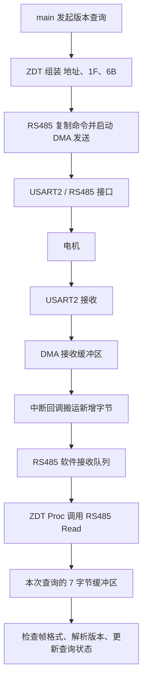

**RS485 与 ZDT 版本查询：对照当前代码阅读**

这份说明对应 [rs485.c](../Core/BSP/rs485.c)、[zdt_x42s.c](../Core/BSP/zdt_x42s.c) 和 [main.c](../Core/Src/main.c) 当前的实现。公开类型和函数声明分别在 [rs485.h](../Core/BSP/rs485.h)、[zdt_x42s.h](../Core/BSP/zdt_x42s.h)。

阅读时先串起一次成功查询，再看缓冲区、中断和异常处理。

**1. 两个模块分别负责什么**

| 模块 | 负责的事情 | 主要保存什么 |
| --- | --- | --- |
| `rs485.c` | 控制收发方向，用串口和 DMA 发送、接收字节，将接收字节放入队列 | 驱动状态、发送缓冲区、DMA 接收缓冲区、接收队列 |
| `zdt_x42s.c` | 组装版本查询命令，累计回复，检查帧格式，提取版本，判断查询是否超时 | 本次查询的地址、状态、收到的字节、版本结果 |
| `main.c` | 初始化外设，发起一次查询，在循环中持续推进处理 | 调用顺序 |

RS485 层处理“字节怎么传”；ZDT 层处理“这些字节代表什么，以及一次查询何时结束”。



**2. 从 main 开始：程序先做什么**

启动时的主要顺序是：

```c
HAL_Init();
SystemClock_Config();

MX_GPIO_Init();
MX_DMA_Init();
MX_TIM6_Init();
MX_USART2_UART_Init();

HAL_TIM_Base_Start_IT(&htim6);
RS485_Init();
HAL_Delay(10U);
ZDT_X42S_StartVersionQuery(0x01U);
```

这里省略了实际代码中的错误处理，方便看清顺序。

`MX_USART2_UART_Init()` 配置串口：115200、8 位数据、无校验、1 位停止位，并配置收发 DMA。接收 DMA 是循环模式，发送 DMA 是普通模式。

`RS485_Init()` 让驱动开始工作：清零队列位置，PG8 拉低进入接收方向，调用 `HAL_UARTEx_ReceiveToIdle_DMA()` 开始持续接收。成功后，驱动状态变成 `READY`。

随后等待 10 ms，再向地址 1 发起版本查询。此前实机对照中，立即发起查询会超时，加入这段等待后查询成功。这是当前硬件已验证的启动等待值；等待发生在第一次查询之前。

进入主循环后，反复执行：

```c
RS485_Proc();       // 检查发送是否超时
KEY_Proc();         // 按键业务
ZDT_X42S_Proc();    // 取出回复、累计、解析、检查查询超时
```

查询只在启动时发起一次。当前主循环没有自动重复查询或自动重试的代码。

`main` 中的错误检查针对初始化和启动查询的返回值；失败时进入 `Error_Handler()`，屏蔽中断并停在死循环。之后查询过程中发生的超时，则记录在 `s_query` 中，不会自动调用 `Error_Handler()`。

**3. 一次成功查询，按时间顺序发生什么**

以查询地址 1 为例。

1. `main` 调用 `ZDT_X42S_StartVersionQuery(1)`。
2. ZDT 检查上一次查询是否仍在等待回复。若是，返回 `RS485_BUSY`。
3. ZDT 调用 `ZDT_X42S_RequestVersion(1)`，组装命令 `01 1F 6B`。
4. `RequestVersion()` 调用 `RS485_SendAsync()`。
5. RS485 检查驱动状态和参数，把命令复制到内部发送缓冲区，记录发送开始时间，将驱动状态设为 `TX_ACTIVE`，PG8 拉高，再启动发送 DMA。
6. 启动发送成功后，调用链返回到 `StartVersionQuery()`。它保存地址，清零本次累计接收长度，记录查询开始时间，把查询状态设为 `WAIT_RESPONSE`，然后返回。
7. 主循环继续运行，发送由 DMA 和串口硬件继续完成。
8. 最后一个字节真正发送完成后，HAL 调用 `HAL_UART_TxCpltCallback()`。回调将 PG8 拉低切回接收方向，并把驱动状态恢复为 `READY`。
9. 电机回复，例如 `01 1F 00 CE 23 14 6B`。DMA 将字节写入接收缓冲区。
10. 串口空闲事件等中断触发接收回调，将新收到的字节搬入软件接收队列。
11. 主循环调用 `ZDT_X42S_Proc()`，通过 `RS485_Read()` 把队列中的字节取到本次查询缓冲区，累加 `rx_len`。
12. 累计到 7 字节后，调用 `ZDT_X42S_ParseVersion()` 检查并解析。通过后，查询状态变为 `SUCCESS`。

第 6 步返回 `RS485_OK` 时，版本信息通常还没回来。只有第 12 步成功后，才能把 `s_query.version` 当作本次查询结果。

**4. 三种“状态”要分清**

| 名称 | 所在位置 | 表示什么 |
| --- | --- | --- |
| `RS485_Result_t` | `rs485.h` | 某一次函数调用的返回结果，例如成功、忙、参数错误 |
| `s_state` / `RS485_State_t` | `rs485.c` | RS485 驱动当前处于什么状态 |
| `s_query.state` / `ZDT_VersionState_t` | `zdt_x42s.c` | 版本查询当前处于什么阶段 |

驱动状态的正常变化：

```text
UNINIT --初始化成功--> READY --启动发送--> TX_ACTIVE
                         ↑                  |
                         └---发送完成回调---┘

初始化失败 / 串口错误 / 发送超时 --> FAULT
```

| 驱动状态 | 含义 |
| --- | --- |
| `UNINIT` | 驱动尚未初始化 |
| `READY` | 驱动可以接受新的发送请求；接收 DMA 已在工作 |
| `TX_ACTIVE` | 一次发送正在进行 |
| `FAULT` | 驱动发生故障，当前实现保持故障状态 |

查询状态的正常变化：

```text
IDLE --启动查询成功--> WAIT_RESPONSE --完整回复且解析通过--> SUCCESS
                           |
                           +--到达查询期限且仍未收齐------> TIMEOUT
                           |
                           +--读取失败或帧格式错误-------> ERROR

启动发送失败也会直接进入 ERROR。
SUCCESS / TIMEOUT / ERROR 后，再次调用 StartVersionQuery 可以尝试新查询。
```

`SUCCESS`、`TIMEOUT`、`ERROR` 都会保持，当前代码没有自动切回 `IDLE`。

一次查询中，两层状态可能这样配合：

| 时间点 | RS485 驱动状态 | ZDT 查询状态 |
| --- | --- | --- |
| 初始化完成 | `READY` | `IDLE` |
| 发起查询、命令正在发送 | `TX_ACTIVE` | `WAIT_RESPONSE` |
| 命令已经发完，等待电机回复 | `READY` | `WAIT_RESPONSE` |
| 收齐并解析成功 | `READY` | `SUCCESS` |
| 电机没有回复，查询超时 | 通常仍为 `READY` | `TIMEOUT` |

因此，驱动已经 `READY` 时，查询仍然可能在等待回复。

**5. 为什么有这么多缓冲区**

| 缓冲区 | 容量 | 谁写入 | 谁读取 | 用途 |
| --- | --- | --- | --- | --- |
| `s_tx_buffer` | 128 字节 | `RS485_SendAsync()` | 发送 DMA | 保证异步发送期间的数据一直存在 |
| `s_dma_rx_buffer` | 128 字节 | 接收 DMA | 接收中断回调 | 硬件接收到的数据首先落在这里 |
| `s_rx_queue` | 256 字节，实际可存 255 字节 | 接收中断回调 | `RS485_Read()` | 保存等待主循环处理的接收字节 |
| `s_query.rx_buf` | 7 字节 | `ZDT_X42S_Proc()` 通过 `RS485_Read()` 写入 | 版本解析函数 | 拼出本次版本查询的完整回复 |

发送方向的数据路径：

```text
RequestVersion 内的局部 cmd[3]
    → memcpy 到 s_tx_buffer
    → DMA 送到 USART2
    → RS485 接口
    → 电机
```

`cmd` 是局部数组，但当前驱动会先复制数据，所以函数返回后，DMA 仍然可以安全使用内部的 `s_tx_buffer`。正在发送时，新发送请求返回 `RS485_BUSY`，避免覆盖这块缓冲区。

接收方向的数据路径：

```text
电机回复
    → USART2
    → s_dma_rx_buffer
    → s_rx_queue
    → s_query.rx_buf
    → s_query.version
```

DMA 缓冲区会循环覆盖；软件队列让中断先把新字节保存下来，主循环随后再取。查询缓冲区则把当前这条版本回复累计完整。

**6. 接收中断回调到底在算什么**

`HAL_UARTEx_RxEventCallback(huart, Size)` 中的 `Size` 表示缓冲区中本次报告的写入终点，当前 HAL 使用 1～128 的位置表示。它不一定是“这次新增的字节数”。

`s_dma_last_pos` 记录上次已经搬运到哪里。回调用新旧位置算出需要搬运的区间：

| 情况 | 要搬运的内容 | 例子 |
| --- | --- | --- |
| `Size > last_pos` | `[last_pos, Size)` | 上次 3，本次 7：搬下标 3、4、5、6，共 4 字节 |
| `Size < last_pos` | 缓冲区末尾，再加开头 | 上次 120，本次 5：搬 120～127，再搬 0～4，共 13 字节 |
| `Size == last_pos` | 当前实现不重复搬运 | 同一位置可能被再次报告 |

搬运完成后，更新 `s_dma_last_pos = Size`。

每搬一个字节，都调用 `RS485_RxPushByte()` 放入软件队列。这个回调只搬字节，版本解析在主循环中完成。

接收回调可由 DMA 半满、DMA 满、串口 IDLE 等事件触发。当前查询只有 7 字节，不到 128 字节 DMA 缓冲区的一半，通常依靠串口 IDLE 事件通知软件处理这 7 字节。

IDLE 表示串口出现了空闲间隔。一次回复可能分几次到达，ZDT 层仍然需要累计长度。

**7. 软件接收队列的 head、tail 和溢出**

`s_rx_head` 表示下一个写入位置，接收回调推进它。

`s_rx_tail` 表示下一个读取位置，主循环里的 `RS485_Read()` 推进它。

```text
head == tail                 → 队列为空
(head + 1) % 256 == tail     → 队列已满
```

为了区分“空”和“满”，数组留一个位置不用，因此实际容量是 255 字节。

写入一个字节的顺序是：先检查空间，再写数组，再更新 `head`。读出一个字节时，先取数组中的值，再更新 `tail`。

队列满时，`RS485_RxPushByte()` 返回 `false`，接收回调设置 `s_rx_overflow = true`。

`RS485_Read()` 在读取前后都会检查溢出。如果发生溢出，就丢弃队列中尚未读取的数据，并返回 `RS485_RX_OVERFLOW`；读取后才发现溢出时，还会将本次返回的 `received` 清零，让上层放弃本次读取结果。

丢弃队列和清溢出标志时，会短暂屏蔽中断，防止接收回调同时修改队列。代码保存并恢复原来的 `PRIMASK`，所以进入函数前若已屏蔽中断，退出时仍保持屏蔽。

**8. RS485_Read 的三个参数与返回值**

```c
RS485_Read(buffer, capacity, &received);
```

| 参数 | 含义 |
| --- | --- |
| `buffer` | 本次把字节存到哪里 |
| `capacity` | 本次最多还能存多少字节 |
| `received` | 输出本次实际取出的字节数 |

它从软件队列中取现有数据，读够 `capacity` 或队列为空就返回。

队列为空时，可以返回 `RS485_OK`，同时 `received == 0`。含义是“读取操作正常，目前没有数据可取”。

它不会一直等待电机回复。参数非法、驱动未初始化、驱动故障、接收队列溢出时，返回相应错误。

另一个查询函数 `RS485_IsTxBusy()` 只判断驱动是否处于 `TX_ACTIVE`。返回 `false` 仅表示当前不是这个发送状态；驱动尚未初始化或已经故障时，它同样返回 `false`，所以使用它不能代替发送函数自身的状态检查。

**9. ZDT 的四个函数分别干什么**

| 函数 | 输入 | 工作 | 结果 |
| --- | --- | --- | --- |
| `ZDT_X42S_RequestVersion()` | 电机地址 | 组装并发送 3 字节查询命令 | 返回启动发送的结果 |
| `ZDT_X42S_StartVersionQuery()` | 电机地址 | 检查是否忙，调用发送，保存本次查询上下文 | 成功后进入 `WAIT_RESPONSE` |
| `ZDT_X42S_Proc()` | 无，通过内部上下文工作 | 读取、累计回复，决定成功、错误或超时 | 更新 `s_query.state` 和查询结果 |
| `ZDT_X42S_ParseVersion()` | 完整数据、长度、期望地址、结果指针 | 检查帧并提取版本字段 | 返回 `true` 或 `false`，成功时写入结果结构体 |

平时由业务代码调用 `StartVersionQuery()` 发起查询，在主循环里持续调用 `Proc()`。

单独调用 `RequestVersion()` 只会发送命令，不会建立查询上下文，也不会让 `Proc()` 自动进入等待状态。

单独调用 `ParseVersion()` 只会检查并解析传入的数据，不会发送命令或读取串口。

**10. s_query 中每个成员的用途**

`ZDT_VersionQueryContext_t` 是结构体类型；`s_query` 是用这个类型定义的具体变量，保存当前这一次查询的全过程。

| 成员 | 含义 | 在哪里更新 |
| --- | --- | --- |
| `state` | 查询阶段 | 启动查询和 `Proc()` |
| `motor_addr` | 本次目标地址，解析时也检查回复地址 | 启动查询成功后 |
| `rx_buf[7]` | 本次累计收到的回复 | `Proc()` 调用 `RS485_Read()` |
| `rx_len` | 本次累计收到多少字节 | 启动时清零，读取后累加 |
| `start_tick` | 本次查询开始的系统时间 | 启动发送成功后 |
| `version` | 解析出来的版本字段 | 解析成功时 |
| `comm_result` | 保存通信操作的结果；查询超时会设为 `RS485_TIMEOUT` | 启动、读取错误、查询超时 |

`s_query` 定义在 `.c` 文件的函数外，并使用 `static`，所以它一直存在，且代码层面的名字只在该文件中可见。

初始化时只写 `.state = ZDT_VERSION_IDLE`，其他成员会初始化为零值。每次重新查询不会重新执行这次静态初始化。

当前 `s_query` 都由主循环调用的函数修改，因此无需仅为了监视就给整个结构体加 `volatile`。RS485 中会被中断和主循环共同访问的状态、队列下标等使用了 `volatile`；互斥修改仍需要前面提到的临界区。

**11. Proc 如何分多轮收齐 7 字节**

核心调用是：

```c
RS485_Read(
    &s_query.rx_buf[s_query.rx_len],
    sizeof(s_query.rx_buf) - s_query.rx_len,
    &count
);

s_query.rx_len += count;
```

第一个参数指向“接着写的位置”，第二个参数是“剩余空间”，`count` 是“本次读到的数量”。

例如，回复分两次到达：

| 处理轮次 | 进入时 `rx_len` | 写入位置 | 剩余空间 | 本次 `count` | 处理后 `rx_len` |
| --- | --- | --- | --- | --- | --- |
| 第一轮 | 0 | `rx_buf[0]` | 7 | 3 | 3 |
| 第二轮 | 3 | `rx_buf[3]` | 4 | 4 | 7 |

随后解析 7 字节，并切换到结束状态。下一轮 `Proc()` 发现状态已不是 `WAIT_RESPONSE`，立即返回。

如果读取正常但本轮没有数据，`count` 为 0，累计长度保持不变，主循环继续做其他事情。

**12. 版本帧到底怎样解析**

查询命令：

```text
01 1F 6B
│  │  └─ 帧尾标记
│  └──── 查询版本命令码
└─────── 电机地址
```

示例回复采用上次实机收到的数据：

```text
下标：  0   1   2   3   4   5   6
数据： 01  1F  00  CE  23  14  6B
```

解析前检查：输入指针有效、长度为 7、地址符合预期、命令码为 `0x1F`、最后一字节为 `0x6B`。任一项失败，返回 `false`。

通过后提取：

| 字段 | 计算方法 | 示例结果 |
| --- | --- | --- |
| `fw_version` | `(frame[2] << 8) \| frame[3]`，代码先将高字节转换为 `uint16_t` | `0x00CE`，十进制 206 |
| `hw_series` | `frame[4] >> 4` | `0x23` 的高 4 位，得到 2 |
| `hw_type` | `frame[4] & 0x0F` | `0x23` 的低 4 位，得到 3 |
| `hw_version` | `frame[5]` | `0x14`，十进制 20 |

当前代码保存的是这些原始数值，没有把它们进一步格式化为版本字符串。

**13. 哪些代码在主循环中执行，哪些由中断触发**

| 执行环境 | 函数或动作 | 作用 |
| --- | --- | --- |
| 启动阶段 | `RS485_Init()` | 开启持续接收 |
| 主循环所属的正常执行流程 | `StartVersionQuery()`、`RequestVersion()`、`RS485_SendAsync()` | 发起发送，保存查询信息 |
| 主循环 | `RS485_Proc()` | 检查发送超时，必要时终止发送 |
| 主循环 | `ZDT_X42S_Proc()`、`RS485_Read()`、`ParseVersion()` | 读取队列、累计回复、解析、检查查询超时 |
| DMA / USART 中断路径 | `HAL_UARTEx_RxEventCallback()` | 把新收到的字节加入队列 |
| USART 发送完成中断路径 | `HAL_UART_TxCpltCallback()` | 释放发送方向，恢复驱动 `READY` |
| HAL 错误处理中断路径 | `HAL_UART_ErrorCallback()` | 切回接收方向，驱动进入 `FAULT` |
| DMA 硬件 | 发送或接收字节搬运 | 在主循环继续执行时推进数据传输 |

中断入口在 `Core/Src/stm32f4xx_it.c`：

```text
DMA1_Stream5_IRQHandler → HAL_DMA_IRQHandler(hdma_usart2_rx)
DMA1_Stream6_IRQHandler → HAL_DMA_IRQHandler(hdma_usart2_tx)
USART2_IRQHandler       → HAL_UART_IRQHandler(huart2)
```

HAL 再根据具体事件调用用户回调。

当前发送 DMA 是普通模式。DMA 完成后，HAL 先开启串口发送完成中断；串口确认最后一个字节发送完，才进入 `HAL_UART_TxCpltCallback()` 切回接收方向。这能保留最后一个字节的完整发送时间。

“异步发送”表示启动传输后函数就返回，硬件和中断继续推进传输。查询业务则靠后续多次 `Proc()` 推进；这里没有额外创建一个线程。

**14. 三个时间值分别管什么**

| 时间 | 起点和用途 | 到时后的行为 |
| --- | --- | --- |
| 启动等待 10 ms | `main` 在初始化后、首次查询前等待 | 等完再启动第一次查询 |
| 发送超时 30 ms | RS485 在启动 DMA 发送前记录时间 | `RS485_Proc()` 发现仍在发送，锁定故障、尝试终止发送、拉低 PG8 |
| 查询超时 100 ms | `StartVersionQuery()` 成功启动发送后记录时间 | `ZDT_X42S_Proc()` 发现还未收齐回复，设置 `TIMEOUT` 和 `RS485_TIMEOUT` |

发送超时保护“这次发送能否结束”，查询超时限制“本次请求是否收到完整回复”。两段计时大致重叠，不是先等 30 ms 再等 100 ms。

`HAL_GetTick() - start_tick` 表示已经过去多久，使用无符号减法，可以处理系统毫秒计数的正常回绕。

两种超时都在 `Proc()` 被调用时检查。主循环长时间阻塞，就会推迟检查。当前 `KEY_Proc()` 调用的电机脉冲函数有 `HAL_Delay()`，所以按键动作发生时，主循环可能较长时间无法处理查询；DMA 和中断仍可能继续接收。

当前 ZDT 代码先检查是否收满，再检查超时。因此，主循环被延迟后，如果此时已取到完整合法帧，仍可能按成功处理；100 ms 并不是一个由硬件中断强制执行的截止点。

**15. 错误处理与容易误解的返回值**

| 观察到的结果 | 应怎样理解 |
| --- | --- |
| `StartVersionQuery()` 返回 `RS485_OK` | 成功启动查询，最终结果还要看查询状态 |
| `RS485_Read()` 返回 `RS485_OK`，`count == 0` | 队列当前为空，读取本身正常 |
| `s_query.state == SUCCESS` | 本次已收齐 7 字节并通过解析 |
| `s_query.state == TIMEOUT` | 检查超时时仍未收齐回复；当前也会记录 `comm_result = RS485_TIMEOUT` |
| `s_query.state == ERROR`，`comm_result != RS485_OK` | 发起发送或读取时遇到了记录下来的错误 |
| `s_query.state == ERROR`，`comm_result == RS485_OK` | 可能是字节已取出，但帧格式没有通过；当前解析失败分支只修改查询状态 |
| RS485 驱动为 `FAULT` | 当前实现不会自动恢复，再次调用 `RS485_Init()` 也返回硬件错误 |

`RS485_Proc()` 处理发送超时时，先在临界区将驱动设为 `FAULT`，再终止发送。这样，即使有迟到的发送完成回调，也不会把已经故障的驱动重新设为 `READY`。

如果 `HAL_UART_AbortTransmit()` 失败，`s_tx_abort_failed` 会被设为 `true`，驱动仍保持故障状态。

**16. 当前代码的使用边界**

当前只有一个 `s_query`，所以同一时刻只保存一次版本查询。查询等待期间，再次启动查询会返回忙。实际使用时还应避免其他业务抢先读走同一 RS485 接收队列里的回复。

一次查询结束后不会自动重试。再次启动查询会清零 `rx_len`，但没有清空 RS485 接收队列，也没有清零旧的 `version`。因此，只有 `state == SUCCESS` 时，才能把版本字段认作本次有效结果。

当前从队列取到的前 7 字节会直接作为候选版本帧，没有逐字节寻找帧头、跳过噪声或自动重新同步的逻辑。连续多次查询时，残留字节、迟到回复和其他设备的数据需要后续进一步处理。

目前结果保存在私有的 `s_query` 中，还没有供其他 `.c` 文件正常读取查询结果的公开接口。调试器可以查看它，后续业务代码若需要使用版本信息，可以再增加获取查询状态和结果的接口。

**17. 对照源码的阅读顺序与监视项**

建议按这个顺序读函数：

```text
main
  → ZDT_X42S_StartVersionQuery
  → ZDT_X42S_RequestVersion
  → RS485_SendAsync
  → HAL_UART_TxCpltCallback
  → HAL_UARTEx_RxEventCallback
  → ZDT_X42S_Proc
  → RS485_Read
  → ZDT_X42S_ParseVersion
```

理解这条成功路径后，再读 `RS485_RxPushByte()`、`RS485_RxCheckAndClearOverflow()` 和 `RS485_Proc()` 的异常处理。

调试时先看整个查询结构体：

```text
'zdt_x42s.c'::s_query
```

需要往下排查时，再看驱动和 DMA：

```text
'rs485.c'::s_state
'rs485.c'::s_dma_last_pos
'rs485.c'::s_rx_head
'rs485.c'::s_rx_tail
huart2.hdmarx->Instance->NDTR
huart2.ErrorCode
```

这些是 GDB 监视表达式。程序暂停时读取，便于把当时的查询状态、队列位置和硬件计数对应起来。
